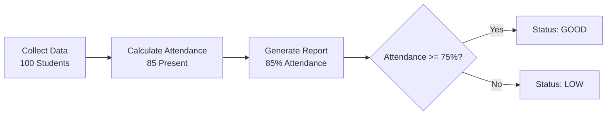

# 🚀 Machine Learning Operations — Assignment 4

## Build Workflow Automation Using Airflow

**Subject:** Machine Learning Operations (MLOps)
**Practical No.:** 4
**Workflow:** Student Attendance Automation
**Tool:** Apache Airflow 3.3.0

---

## 📌 Problem Statement

Build and execute a workflow automation pipeline using Apache Airflow to collect student data, calculate attendance percentage, and generate an attendance report automatically.

The workflow consists of three sequential tasks:

```text
Collect Data → Calculate Attendance → Generate Report
```

---

## 🧠 What is Apache Airflow?

Apache Airflow is an open-source platform used to programmatically author, schedule, and monitor workflows.

In MLOps, Airflow can be used to automate and manage multi-step pipelines such as:

* Data collection
* Data preprocessing
* Model training
* Model evaluation
* Report generation
* Scheduled ML workflows

Airflow represents a workflow as a **DAG (Directed Acyclic Graph)** where tasks are connected according to their execution dependencies.

---

## 🎯 Objectives

* Create an Airflow DAG for workflow automation.
* Define multiple tasks using Airflow's TaskFlow API.
* Pass data between tasks.
* Define task dependencies.
* Execute the workflow through Airflow.
* Monitor task execution using the Airflow UI.
* Verify the generated output using task logs.

---

## 🛠️ Technologies Used

| Technology           | Purpose                   |
| -------------------- | ------------------------- |
| Python 3.14.4        | Programming language      |
| Apache Airflow 3.3.0 | Workflow orchestration    |
| Ubuntu / WSL         | Execution environment     |
| VS Code              | Code development          |
| SQLite               | Airflow metadata database |
| Git & GitHub         | Version control           |

---

## 🔄 Workflow Architecture



### Workflow

#### Collect Data

```text
Total students = 100
```

#### Calculate Attendance

```text
Present students = 85

Attendance = (85 / 100) × 100

Attendance = 85%
```

#### Generate Report

Attendance is checked against **75%**.

Since attendance is **85%**, the status becomes **GOOD**.

---

# ⚙️ Airflow Concepts Implemented

## 1. DAG

A DAG (Directed Acyclic Graph) defines the workflow and its execution structure.

Our DAG is named:

```text
student_attendance_workflow
```

---

## 2. Tasks

The workflow contains three tasks:

```text
collect_data
calculate_attendance
generate_report
```

---

## 3. TaskFlow API

The assignment uses Airflow's TaskFlow API:

```python
from airflow.sdk import dag, task
```

The `@task` decorator converts Python functions into Airflow tasks.

---

## 4. Task Dependencies

The tasks are executed sequentially:

```text
collect_data
      ↓
calculate_attendance
      ↓
generate_report
```

---

## 5. XCom Data Passing

The output of one task is passed to the next task.

```python
total_students = collect_data()
attendance = calculate_attendance(total_students)
generate_report(attendance)
```

This allows:

```text
collect_data
     ↓
total_students
     ↓
calculate_attendance
     ↓
attendance
     ↓
generate_report
```

---

## 6. Manual Workflow Execution

The DAG was configured with:

```python
schedule=None
```

Therefore, the workflow can be triggered manually from Airflow.

---

## 7. Catchup Disabled

```python
catchup=False
```

This prevents Airflow from creating historical scheduled runs for the DAG.

---

# 📚 Important MLOps Concepts

Although this assignment does not train an ML model, it demonstrates important MLOps workflow orchestration concepts.

### Workflow Automation

Instead of manually executing every step, Airflow manages the execution of multiple tasks.

### Pipeline Orchestration

Airflow controls the order in which pipeline tasks execute.

### Task Dependency Management

Each task depends on the successful completion of the previous task.

### Reproducibility

The workflow is defined as Python code, allowing the same workflow to be executed consistently.

### Monitoring

Airflow provides a UI for monitoring:

* DAG runs
* Task states
* Task execution
* Logs
* Failed/successful tasks

### Pipeline Observability

Task logs provide information about what happened during execution.

---

# 🧮 Attendance Calculation

The assignment uses the following formula:

```text
Attendance = (Present Students / Total Students) × 100
```

### Given

```text
Total Students = 100
Present Students = 85
```

Therefore:

```text
Attendance = (85 / 100) × 100
           = 85%
```

The status condition is:

```python
if attendance >= 75:
    print("Status: GOOD")
else:
    print("Status: LOW")
```

### Output

```text
Status: GOOD
```

---

# 💻 Important Code

## DAG Definition

```python
@dag(
    dag_id="student_attendance_workflow",
    start_date=datetime(2026, 8, 1),
    schedule=None,
    catchup=False
)
def student_attendance_workflow():
```

### Explanation

* `dag_id` identifies the workflow.
* `start_date` defines the DAG start date.
* `schedule=None` disables automatic scheduling.
* `catchup=False` disables historical catchup runs.

---

## Collect Data Task

```python
@task
def collect_data():
    print("Step 1: Collecting student data...")

    total_students = 100

    print(f"Total Students: {total_students}")

    return total_students
```

This task creates the total number of students and returns the value to the next task.

---

## Calculate Attendance Task

```python
@task
def calculate_attendance(total_students):

    present_students = 85

    attendance = (present_students / total_students) * 100

    print(f"Present Students: {present_students}")
    print(f"Attendance: {attendance}%")

    return attendance
```

This task receives the total number of students from the previous task and calculates the attendance percentage.

---

## Generate Report Task

```python
@task
def generate_report(attendance):

    print("STUDENT ATTENDANCE REPORT")
    print(f"Attendance: {attendance}%")

    if attendance >= 75:
        print("Status: GOOD")
    else:
        print("Status: LOW")

    print("Report Generated Successfully!")
```

This task receives the calculated attendance and generates the final report.

---

## Task Dependency

```python
total_students = collect_data()
attendance = calculate_attendance(total_students)
generate_report(attendance)
```

This creates the workflow:

```text
Collect Data
     ↓
Calculate Attendance
     ↓
Generate Report
```

---

# 🗂️ Project Structure

```text
Assignment-4/
│
├── .gitignore
│
└── airflow/
    │
    ├── airflow.cfg
    │
    └── dags/
        │
        └── student_attendance_workflow.py
```

Runtime files such as the virtual environment, Airflow logs, and database runtime files are excluded using `.gitignore`.

---

# ⌨️ Important Commands Used

## Create Virtual Environment

```bash
python3 -m venv .venv
```

## Activate Virtual Environment

```bash
source .venv/bin/activate
```

## Install Airflow

```bash
pip install "apache-airflow==3.3.0"
```

## Set Airflow Home

```bash
export AIRFLOW_HOME=/mnt/d/COLLEGE/SEM5/MLOPs/Assignments/Assignment-4/airflow
```

## Initialize Airflow Database

```bash
airflow db migrate
```

## Check DAGs

```bash
airflow dags list
```

## Trigger DAG

```bash
airflow dags trigger student_attendance_workflow
```

## Start Scheduler

```bash
airflow scheduler
```

## Start Airflow API Server

```bash
airflow api-server
```

The Airflow UI can then be accessed locally through:

```text
http://localhost:8080
```

---

# 📊 Execution Result

The workflow was successfully executed through Apache Airflow.

## Task Execution

| Task                   | Result    |
| ---------------------- | --------- |
| `collect_data`         | ✅ Success |
| `calculate_attendance` | ✅ Success |
| `generate_report`      | ✅ Success |

## Final Output

```text
---------------------------
 STUDENT ATTENDANCE REPORT
---------------------------
Attendance: 85%
Status: GOOD
Report Generated Successfully!
```

The Airflow task log also confirmed:

```text
Task instance in success state
```

---

# 📸 Output Verification

The workflow was verified through the Airflow UI and task logs.

Important screenshots include:

* Airflow DAG list showing `student_attendance_workflow`
* DAG graph showing the three sequential tasks
* Generate Report task log showing:

  * `Attendance: 85%`
  * `Status: GOOD`
  * `Report Generated Successfully!`
  * Task instance in success state

---

# ✅ Result

The Student Attendance Workflow was successfully created and executed using Apache Airflow.

The workflow automatically performed the following sequence:

```text
Collect Student Data
        ↓
Calculate Attendance
        ↓
Generate Attendance Report
```

The workflow calculated an attendance percentage of **85%** from **100 total students** and **85 present students**. Since the attendance was at least **75%**, the generated report displayed:

```text
Status: GOOD
```

All three Airflow tasks executed successfully and the result was verified through the Airflow task logs.

---

# 🏁 Conclusion

This assignment demonstrates how Apache Airflow can be used for workflow automation and orchestration in an MLOps environment. The implementation shows DAG creation, task definition, task dependencies, data passing between tasks, manual execution, monitoring, and log-based verification.
