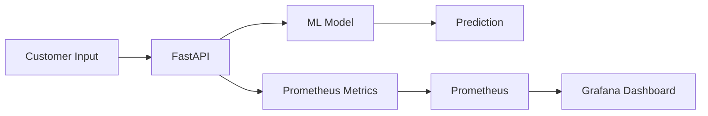
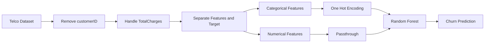
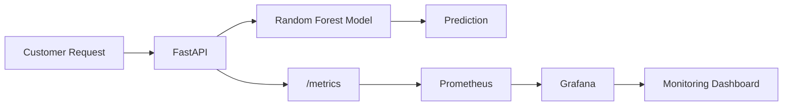
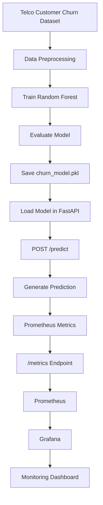

# MLOps Assignment 8 — ML Model Monitoring with Prometheus and Grafana

> **Monitoring a Telco Customer Churn Prediction Model using FastAPI, Prometheus and Grafana**

---

## 📌 1. Problem Statement

Machine Learning models deployed in production need to be monitored continuously to understand how the prediction service is performing.

In this assignment, a Telco Customer Churn Prediction model is trained and deployed as a FastAPI REST API. The API is instrumented with Prometheus metrics, and Grafana is used to visualize these metrics through a monitoring dashboard.

The complete workflow demonstrates how an ML prediction service can be monitored after deployment.

---

## 🎯 2. Objectives

The main objectives of this assignment are:

* Train a Machine Learning model for customer churn prediction.
* Deploy the trained model using FastAPI.
* Add monitoring metrics to the prediction API.
* Collect metrics using Prometheus.
* Visualize model/API metrics using Grafana.
* Monitor:

  * Number of prediction requests
  * Number of churn predictions
  * Churn probability
  * Prediction latency
* Understand the basic workflow of ML model monitoring.

---

## 🧠 3. What is ML Model Monitoring?

ML Model Monitoring is the process of continuously observing a deployed ML model and its prediction service.

Monitoring helps answer questions such as:

* How many prediction requests are being received?
* How long does each prediction take?
* How many customers are predicted to churn?
* What is the latest churn probability?
* Is the prediction service working correctly?

### Monitoring Flow



---

## 📊 4. Dataset

### Dataset Used

**IBM Telco Customer Churn Dataset**

The dataset contains information about telecom customers and whether they left the company.

### Dataset Details

| Property            | Value                |
| ------------------- | -------------------- |
| Dataset             | Telco Customer Churn |
| Records             | 7043                 |
| Original Columns    | 21                   |
| Target Variable     | Churn                |
| Target Classes      | Yes, No              |
| Customer Identifier | customerID           |

The dataset contains customer information such as:

* Gender
* Senior citizen status
* Partner
* Dependents
* Tenure
* Phone service
* Internet service
* Online security
* Online backup
* Device protection
* Technical support
* Streaming services
* Contract type
* Payment method
* Monthly charges
* Total charges

---

## 🤖 5. Machine Learning Model

The assignment uses a:

### Random Forest Classifier

Random Forest is an ensemble Machine Learning algorithm that combines multiple decision trees to make predictions.

### Why Random Forest?

* Handles both numerical and categorical features after preprocessing.
* Works well for classification problems.
* Can capture nonlinear relationships.
* Provides probability estimates using `predict_proba()`.

### Model Configuration

```python
RandomForestClassifier(
    n_estimators=150,
    max_depth=12,
    random_state=42,
    n_jobs=-1
)
```

### Train-Test Split

The dataset was divided into:

* 80% training data
* 20% testing data

Stratified splitting was used to preserve the class distribution.

---

## 🔧 6. Data Preprocessing

The following preprocessing steps were performed.

### Step 1 — Remove Customer ID

`customerID` is an identifier and does not provide useful predictive information.

```python
data = data.drop("customerID", axis=1)
```

### Step 2 — Convert TotalCharges

`TotalCharges` was converted into numeric format.

```python
data["TotalCharges"] = pd.to_numeric(
    data["TotalCharges"],
    errors="coerce"
)
```

### Step 3 — Handle Missing Values

Missing `TotalCharges` values were replaced with the median.

```python
data["TotalCharges"] = data["TotalCharges"].fillna(
    data["TotalCharges"].median()
)
```

### Step 4 — Encode Target

```python
y = data["Churn"].map({
    "No": 0,
    "Yes": 1
})
```

### Step 5 — Encode Categorical Features

OneHotEncoder was used for categorical features.

```python
OneHotEncoder(handle_unknown="ignore")
```

---

## 🏗️ 7. ML Pipeline


```

A Scikit-learn pipeline was created to combine preprocessing and model training.

The complete pipeline was saved as:

```text
models/churn_model.pkl
```

---

## 📈 8. Model Result

The trained model achieved:

**Accuracy: 0.7977**

Therefore, the test accuracy was approximately:

**79.77%**

The trained model was saved using Joblib.

```python
joblib.dump(
    pipeline,
    "models/churn_model.pkl"
)
```

---

## 🚀 9. FastAPI Deployment

The trained model was deployed using FastAPI.

FastAPI provides REST API endpoints through which users/applications can send customer information and receive churn predictions.

### Main API

```text
http://127.0.0.1:8000
```

### Swagger Documentation

```text
http://127.0.0.1:8000/docs
```

---

## 🔌 10. API Endpoints

### GET `/`

Checks whether the API is running.

#### Response

```json
{
  "message": "Telco Customer Churn Prediction API",
  "status": "running"
}
```

### POST `/predict`

Accepts customer information and returns the predicted churn class and probability.

#### Example Input

```json
{
  "gender": "Female",
  "SeniorCitizen": 0,
  "Partner": "Yes",
  "Dependents": "No",
  "tenure": 1,
  "PhoneService": "No",
  "MultipleLines": "No phone service",
  "InternetService": "DSL",
  "OnlineSecurity": "No",
  "OnlineBackup": "Yes",
  "DeviceProtection": "No",
  "TechSupport": "No",
  "StreamingTV": "No",
  "StreamingMovies": "No",
  "Contract": "Month-to-month",
  "PaperlessBilling": "Yes",
  "PaymentMethod": "Electronic check",
  "MonthlyCharges": 29.85,
  "TotalCharges": 29.85
}
```

#### Example Response

```json
{
  "churn_prediction": "No",
  "churn_probability": 0.3606
}
```

---

## 📊 11. Prometheus Monitoring

### What is Prometheus?

Prometheus is an open-source monitoring and time-series database system.

In this assignment, Prometheus collects metrics exposed by the FastAPI application.

### Monitoring Architecture


---

## 📌 12. Prometheus Metrics

The FastAPI application exposes four custom ML/API metrics.

### 1. Prediction Request Count

`prediction_requests_total`

Counts the total number of prediction requests received.

Implemented using:

```python
REQUEST_COUNT = Counter(
    "prediction_requests_total",
    "Total number of prediction requests"
)
```

### 2. Churn Prediction Count

`churn_predictions_total`

Counts predictions based on the predicted class.

#### Labels

* `prediction="Yes"`
* `prediction="No"`

Implemented using:

```python
PREDICTION_COUNT = Counter(
    "churn_predictions_total",
    "Total churn predictions",
    ["prediction"]
)
```

### 3. Churn Probability

`churn_probability`

Stores the latest predicted probability of customer churn.

Implemented using:

```python
CHURN_PROBABILITY = Gauge(
    "churn_probability",
    "Latest predicted churn probability"
)
```

### 4. Prediction Latency

`prediction_latency_seconds`

Measures the time required to process a prediction request.

Implemented using:

```python
REQUEST_LATENCY = Histogram(
    "prediction_latency_seconds",
    "Prediction request latency"
)
```

---

## 🔍 13. `/metrics` Endpoint

Prometheus collects metrics from:

```text
http://127.0.0.1:8000/metrics
```

The FastAPI application generates the Prometheus metrics using:

```python
generate_latest()
```

and returns them as plain text.

---

## ⚙️ 14. Prometheus Configuration

The project uses:

```text
prometheus/prometheus.yml
```

### Configuration

```yaml
global:
  scrape_interval: 5s

scrape_configs:
  - job_name: "fastapi"
    static_configs:
      - targets: ["127.0.0.1:8000"]
```

### Important Configuration

```text
scrape_interval: 5s
```

This means Prometheus attempts to collect metrics from the FastAPI application every 5 seconds.

---

## 📊 15. Grafana Dashboard

### What is Grafana?

Grafana is an open-source visualization and dashboard platform.

It was used to visualize the metrics collected by Prometheus.

Prometheus acts as the data source, while Grafana provides the visual interface.

### Data Flow



---

## 📋 16. Grafana Dashboard Panels

The dashboard contains four panels.

| Panel                      | PromQL / Metric                                                     | Purpose                          |
| -------------------------- | ------------------------------------------------------------------- | -------------------------------- |
| Total Prediction Requests  | `prediction_requests_total`                                         | Shows total API requests         |
| Churn Predictions          | `churn_predictions_total`                                           | Shows churn prediction counts    |
| Latest Churn Probability   | `churn_probability`                                                 | Shows latest churn probability   |
| Average Prediction Latency | `prediction_latency_seconds_sum / prediction_latency_seconds_count` | Shows average prediction latency |

### Average Prediction Latency

The average latency was calculated using:

```text
prediction_latency_seconds_sum / prediction_latency_seconds_count
```

This calculates:

```text
Total observed latency
----------------------
Number of observations
```

---

## 🧪 17. Testing

The API was tested using the FastAPI Swagger UI.

### Swagger URL

```text
http://127.0.0.1:8000/docs
```

Multiple prediction requests were submitted.

Different customer inputs were tested to demonstrate that the monitoring metrics change dynamically.

The final dashboard demonstrated both prediction classes:

```text
Churn = No → 6
Churn = Yes → 1
```

Total prediction requests:

```text
7
```

The dashboard also displayed the latest churn probability and prediction latency.

---

## 🛠️ 18. Technologies Used

| Technology    | Purpose                                      |
| ------------- | -------------------------------------------- |
| Python        | Programming language                         |
| Pandas        | Dataset processing                           |
| NumPy         | Numerical operations through ML dependencies |
| Scikit-learn  | Machine Learning and preprocessing           |
| Random Forest | Churn classification                         |
| Joblib        | Model serialization                          |
| FastAPI       | ML REST API                                  |
| Uvicorn       | ASGI server                                  |
| Prometheus    | Metrics collection and monitoring            |
| Grafana       | Metrics visualization                        |
| Pydantic      | API input validation                         |
| Ubuntu/WSL    | Development environment                      |
| VS Code       | Code editing                                 |

---

## 📁 19. Project Structure

```text
Assignment-8/
│
├── app/
│   └── main.py
│
├── data/
│   └── telco_churn.csv
│
├── grafana/
│   └── churn_monitoring_dashboard.json
│
├── models/
│   └── churn_model.pkl
│
├── prometheus/
│   ├── prometheus.yml
│   └── data/
│
├── .venv/
│
└── train_model.py
```

---

## 💻 20. Setup Instructions

The following steps were performed using Ubuntu/WSL.

### Step 1 — Navigate to Assignment Directory

```bash
cd /mnt/d/COLLEGE/SEM5/MLOPs/Assignments
```

Create/open the assignment directory:

```bash
mkdir -p Assignment-8
cd Assignment-8
```

### Step 2 — Create Project Directories

```bash
mkdir -p app models prometheus grafana data
```

### Step 3 — Create Virtual Environment

```bash
python3 -m venv .venv
```

Activate it:

```bash
source .venv/bin/activate
```

---

## 📦 21. Install Python Dependencies

```bash
pip install fastapi uvicorn prometheus-client scikit-learn pandas joblib
```

The main packages are:

* `fastapi`
* `uvicorn`
* `prometheus-client`
* `scikit-learn`
* `pandas`
* `joblib`

---

## 📥 22. Download Dataset

The IBM Telco Customer Churn dataset was downloaded using:

```bash
wget https://raw.githubusercontent.com/IBM/telco-customer-churn-on-icp4d/master/data/Telco-Customer-Churn.csv \
-O data/telco_churn.csv
```

---

## 🏋️ 23. Train the Model

Run:

```bash
python train_model.py
```

The model is saved to:

```text
models/churn_model.pkl
```

---

## 🚀 24. Start FastAPI

Run:

```bash
uvicorn app.main:app --reload
```

FastAPI starts at:

```text
http://127.0.0.1:8000
```

Swagger:

```text
http://127.0.0.1:8000/docs
```

Metrics:

```text
http://127.0.0.1:8000/metrics
```

---

## 📡 25. Start Prometheus

The Assignment-8 Prometheus instance runs on port `9091`.

```bash
prometheus \
  --config.file=prometheus/prometheus.yml \
  --storage.tsdb.path=prometheus/data \
  --web.listen-address=0.0.0.0:9091
```

### Prometheus dashboard

```text
http://localhost:9091
```

### Check Targets

Open:

```text
http://localhost:9091/classic/targets
```

The FastAPI target should show:

```text
State: UP
```

---

## 📊 26. Start Grafana

Grafana was installed using the official Grafana `.deb` package.

### Start Grafana

```bash
sudo systemctl start grafana-server
```

### Check status

```bash
sudo systemctl status grafana-server --no-pager
```

### Grafana

```text
http://localhost:3000
```

---

## 🔗 27. Configure Grafana Data Source

Inside Grafana:

1. Open **Connections / Data Sources**
2. Add Prometheus
3. Set the URL to:

```text
http://localhost:9091
```

4. Click **Save & Test**

Grafana should successfully connect to Prometheus.

---

## 📊 28. Important PromQL Queries

### Total Requests

```text
prediction_requests_total
```

### Churn Predictions

```text
churn_predictions_total
```

### Latest Churn Probability

```text
churn_probability
```

### Average Prediction Latency

```text
prediction_latency_seconds_sum / prediction_latency_seconds_count
```

---

## 🔄 29. Complete Assignment Workflow



---

## 🧩 30. Role of Each Tool

### Python

Used to implement the complete ML pipeline and API.

### Pandas

Used for loading and preprocessing the Telco dataset.

### Scikit-learn

Used for:

* Train-test splitting
* One-hot encoding
* Pipeline creation
* Random Forest classification
* Model evaluation

### Joblib

Used to save and load the trained ML pipeline.

### FastAPI

Provides the prediction REST API.

### Uvicorn

Runs the FastAPI application.

### Prometheus

Collects and stores time-series monitoring metrics.

### Grafana

Visualizes Prometheus metrics using dashboards.

### Pydantic

Validates customer input received by the API.

---

## 📌 31. Important Ports

| Service               | Port |
| --------------------- | ---: |
| FastAPI               | 8000 |
| Assignment Prometheus | 9091 |
| Grafana               | 3000 |

> **Note:** Port 9091 was used for the Assignment-8 Prometheus instance because another Prometheus service was already using port 9090.

---

## 📄 32. Grafana Dashboard Export

The Grafana dashboard configuration was exported and stored in:

```text
grafana/churn_monitoring_dashboard.json
```

This allows the dashboard configuration to be included with the assignment project.

---

## ✅ 33. Final Result

The assignment successfully demonstrates an end-to-end ML monitoring workflow:

```text
Dataset
   ↓
Preprocessing
   ↓
Random Forest Model
   ↓
FastAPI Prediction API
   ↓
Prometheus Metrics
   ↓
Prometheus
   ↓
Grafana Dashboard
```

The trained model achieved an accuracy of 79.77% on the test set.

The deployed API successfully generated predictions, while Prometheus collected request count, prediction count, churn probability, and latency metrics. Grafana then visualized these metrics through a monitoring dashboard.

---

## 🏁 34. Conclusion

This assignment demonstrates how a Machine Learning model can be monitored after deployment using FastAPI, Prometheus, and Grafana.

The Telco Customer Churn model was trained using Random Forest and deployed as a FastAPI service. Custom Prometheus metrics were added to monitor prediction requests, prediction classes, churn probability, and prediction latency. Prometheus collected these metrics and Grafana provided a visual dashboard for monitoring them.

Therefore, the assignment provides a practical implementation of ML model serving and monitoring in an MLOps workflow.
