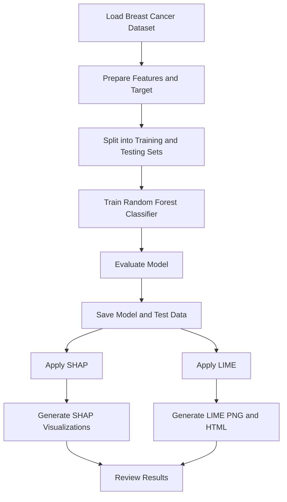

# 🔍 Assignment 9: Model Explainability Using SHAP and LIME

<p align="center">
  <strong>Machine Learning and Operations (MLOps)</strong><br>
  Explainable Machine Learning with SHAP, LIME, and Random Forest
</p>

---

## 📌 Problem Statement

Machine learning models can make accurate predictions, but understanding why a model makes a particular prediction is equally important. Complex models such as Random Forests are not always easy to interpret directly.

The objective of this assignment is to implement **SHAP (SHapley Additive exPlanations)** and **LIME (Local Interpretable Model-agnostic Explanations)** to explain the predictions of a trained machine learning classification model.

The assignment demonstrates global feature importance and individual prediction explanations using visualizations and reports.

## 🎯 Objectives

- Train a machine learning classification model using scikit-learn.
- Evaluate model performance using accuracy, precision, recall, F1-score, and a confusion matrix.
- Apply SHAP to understand feature contributions across multiple predictions and for an individual prediction.
- Apply LIME to explain an individual prediction using an interpretable local approximation.
- Generate and save visualizations and explanation reports.
- Understand the importance of transparency and interpretability in machine learning.

## 🧠 Technologies Used

| Technology | Purpose |
|---|---|
| Python | Implementation language |
| NumPy | Numerical operations |
| Pandas | Dataset handling and data processing |
| Scikit-learn | Dataset loading, model training, and evaluation |
| Random Forest Classifier | Machine learning classification model |
| SHAP | Model explainability using feature contributions |
| LIME | Local, model-agnostic prediction explanations |
| Matplotlib | Visualization generation |
| Joblib | Saving and loading the trained model |
| Ubuntu (WSL) | Terminal operations and Python execution |
| Visual Studio Code | Writing and editing Python code |

## 📊 Dataset

**Dataset:** Breast Cancer Wisconsin dataset

The dataset is loaded directly from `sklearn.datasets.load_breast_cancer()`. Therefore, a separate dataset download is not required.

| Property | Details |
|---|---|
| Total samples | 569 |
| Input features | 30 numerical features |
| Target classes | Malignant and Benign |
| Training samples | 455 |
| Testing samples | 114 |
| Test size | 20% |
| Random state | 42 |
| Split strategy | Stratified train-test split |

The dataset contains numerical measurements derived from breast cancer cell nuclei. The target variable represents two classes:

- **Malignant (0):** Malignant classification.
- **Benign (1):** Benign classification.

The model uses these numerical features to predict the class of a sample.

> **Note:** This assignment is an educational machine learning exercise, not a medical diagnostic tool.

## ⚙️ Model Used

### Random Forest Classifier

Random Forest is an ensemble learning algorithm that combines predictions from multiple decision trees to perform classification.

The model is configured with:

- `n_estimators=100`: Uses 100 decision trees.
- `random_state=42`: Ensures reproducibility.
- `stratify=y`: Maintains class proportions in the training and testing sets.

The trained model is saved using Joblib and reused by both SHAP and LIME, ensuring that both explainability techniques analyze the same model.

## 🔬 Understanding SHAP and LIME

### 1. SHAP

SHAP explains predictions by assigning each feature a contribution value based on Shapley values from cooperative game theory.

In this assignment, SHAP generates three visualizations:

| Output | Purpose |
|---|---|
| `shap_summary.png` | Shows feature contributions across multiple samples |
| `shap_feature_importance.png` | Ranks features using mean absolute SHAP values |
| `shap_waterfall.png` | Explains how individual features contribute to one prediction relative to a baseline |

**Interpretation:** Positive SHAP values push the explained model output toward the selected class, while negative values push it in the opposite direction. The exact interpretation depends on the output being explained.

The summary plot shows both the magnitude and direction of feature contributions. The bar plot summarizes average contribution magnitude.

### 2. LIME

LIME stands for Local Interpretable Model-agnostic Explanations.

It explains an individual prediction by generating perturbed samples around the selected instance and fitting a simpler interpretable model locally.

In this assignment, LIME generates:

| Output | Purpose |
|---|---|
| `lime_explanation.png` | Visualizes the feature contributions for one prediction |
| `lime_explanation.html` | Displays the prediction probabilities, feature contributions, and feature values in a browser |

The generated report for the selected sample showed a malignant probability of `1.0000` and a benign probability of `0.0000`.

The strongest local contributions included features such as `worst concave points`, `worst area`, and `worst radius`.

These contributions explain the selected prediction and should not be interpreted as global feature importance or causal effects.

## 🔄 Project Workflow



## 📁 Project Structure

```text
Assignment-9/
│
├── .venv/
│
├── results/
│   ├── random_forest_model.pkl
│   ├── X_test.csv
│   ├── y_test.csv
│   ├── feature_importance.png
│   ├── shap_summary.png
│   ├── shap_feature_importance.png
│   ├── shap_waterfall.png
│   ├── lime_explanation.png
│   └── lime_explanation.html
│
├── requirements.txt
├── train_model.py
├── shap_explainability.py
├── lime_explainability.py
└── README.md
```

**File descriptions:**

- `train_model.py`: Loads the dataset, trains and evaluates the classifier, and saves the model, test data, and feature-importance chart.
- `shap_explainability.py`: Loads the saved model and generates SHAP summary, bar, and waterfall plots.
- `lime_explainability.py`: Generates a local LIME explanation and saves it as PNG and HTML.
- `requirements.txt`: Lists the required Python packages.
- `results/`: Contains the trained model, test data, and generated explainability outputs.
- `.venv/`: Contains the isolated Python environment and should not be committed to GitHub.

## 🚀 Setup and Execution

### Prerequisites

- Ubuntu or Ubuntu through WSL.
- Python 3.
- Visual Studio Code.
- Internet access for installing Python packages.

All terminal commands below are intended for the Ubuntu terminal, except where otherwise indicated.

### Step 1: Navigate to the assignment directory

```bash
cd /mnt/d/COLLEGE/SEM5/MLOPs/Assignments/Assignment-9
```

Verify the current location:

```bash
pwd
```

### Step 2: Create and activate the virtual environment

```bash
python3 -m venv .venv
```

Activate the environment:

```bash
source .venv/bin/activate
```

Upgrade pip:

```bash
python -m pip install --upgrade pip
```

Verify the active Python executable:

```bash
which python
```

The output should point to `Assignment-9/.venv/bin/python`.

### Step 3: Install dependencies

The required libraries are listed in `requirements.txt`:

```text
numpy
pandas
matplotlib
scikit-learn
shap
lime
```

Install them using:

```bash
python -m pip install -r requirements.txt
```

Verify that the libraries can be imported:

```bash
python -c 'import numpy, pandas, matplotlib, sklearn, shap, lime; print("All libraries imported successfully")'
```

### Step 4: Open the project in VS Code

```bash
code .
```

Create and edit the Python scripts in VS Code. Save each file before executing it.

### Step 5: Train the classification model

```bash
python train_model.py
```

This command trains the Random Forest model and generates:

- `results/random_forest_model.pkl`
- `results/X_test.csv`
- `results/y_test.csv`
- `results/feature_importance.png`

The terminal displays the dataset split sizes, accuracy, classification report, and confusion matrix.

### Step 6: Generate SHAP explanations

```bash
python shap_explainability.py
```

Generated files:

- `results/shap_summary.png`
- `results/shap_feature_importance.png`
- `results/shap_waterfall.png`

### Step 7: Generate LIME explanations

```bash
python lime_explainability.py
```

Generated files:

- `results/lime_explanation.png`
- `results/lime_explanation.html`

To open the HTML report from Ubuntu on Windows:

```bash
explorer.exe "$(wslpath -w "$PWD/results/lime_explanation.html")"
```

The report opens in the default web browser.

### Step 8: Verify the generated files

```bash
find results -maxdepth 1 -type f -printf '%f\n' | sort
```

The output should list the saved model, test datasets, feature-importance chart, three SHAP visualizations, and two LIME reports.

## 💻 Implementation Details

### 1. Model Training — `train_model.py`

**Dataset loading**

```python
from sklearn.datasets import load_breast_cancer

dataset = load_breast_cancer()
X = pd.DataFrame(dataset.data, columns=dataset.feature_names)
y = pd.Series(dataset.target, name="target")
```

This loads the built-in dataset and separates the numerical input features from the target labels.

**Train-test split**

```python
X_train, X_test, y_train, y_test = train_test_split(
    X, y, test_size=0.2, random_state=42, stratify=y
)
```

This reserves 20% of the samples for evaluation and maintains class proportions through stratification.

**Model training**

```python
model = RandomForestClassifier(
    n_estimators=100,
    random_state=42
)
model.fit(X_train, y_train)
```

The classifier learns patterns from the training dataset.

**Evaluation and model saving**

```python
y_pred = model.predict(X_test)
accuracy = accuracy_score(y_test, y_pred)

joblib.dump(model, "results/random_forest_model.pkl")
X_test.to_csv("results/X_test.csv", index=False)
y_test.to_csv("results/y_test.csv", index=False)
```

The model is evaluated on the held-out test dataset. Joblib saves the trained classifier, and Pandas saves the test data for subsequent explanation scripts.

### 2. SHAP — `shap_explainability.py`

**Create the explainer**

```python
explainer = shap.TreeExplainer(model)
shap_values = explainer.shap_values(X_sample)
```

`TreeExplainer` is suitable for tree-based models such as Random Forest. It calculates feature contributions for the selected samples.

**Generate a summary plot**

```python
shap.summary_plot(
    values_to_plot,
    X_sample,
    show=False,
    max_display=15
)
```

The summary plot displays the contributions of the 15 most prominent features for the selected sample of 50 test instances.

**Generate a feature-importance plot**

```python
shap.summary_plot(
    values_to_plot,
    X_sample,
    plot_type="bar",
    show=False,
    max_display=15
)
```

The bar plot summarizes average absolute SHAP contributions across the selected instances.

**Generate an individual explanation**

```python
shap.plots.waterfall(explanation, max_display=15, show=False)
```

The waterfall plot visualizes how feature contributions move the selected output away from its baseline.

The script handles different SHAP output formats for binary classification.

### 3. LIME — `lime_explainability.py`

**Create the LIME explainer**

```python
explainer = LimeTabularExplainer(
    training_data=X_test.to_numpy(),
    feature_names=X_test.columns.tolist(),
    class_names=["malignant", "benign"],
    mode="classification",
    discretize_continuous=True,
    random_state=42
)
```

This initializes LIME for tabular classification. Continuous features are discretized into intervals to make the resulting explanation easier to interpret.

**Explain an individual prediction**

```python
explanation = explainer.explain_instance(
    data_row=instance,
    predict_fn=predict_fn,
    labels=(prediction,),
    num_features=10,
    num_samples=3000
)
```

LIME creates perturbed samples, queries the trained classifier, and fits a local interpretable approximation. The explanation contains up to 10 feature contributions based on 3,000 perturbed samples.

**Save the explanation**

```python
explanation.save_to_file("results/lime_explanation.html")

fig = explanation.as_pyplot_figure(label=prediction)
fig.savefig(
    "results/lime_explanation.png",
    dpi=300,
    bbox_inches="tight"
)
```

The HTML report contains the prediction probabilities, feature contributions, and feature values. The PNG provides a static visualization.

## 📈 Results

### Model performance

The Random Forest classifier achieved the following results on the held-out test set:

| Metric | Result |
|---|---:|
| Test accuracy | 95.61% |
| Test samples | 114 |
| Malignant precision | 0.95 |
| Malignant recall | 0.93 |
| Malignant F1-score | 0.94 |
| Benign precision | 0.96 |
| Benign recall | 0.97 |
| Benign F1-score | 0.97 |

### Confusion matrix

The model produced the following confusion matrix, using the class order malignant followed by benign:

| Actual / Predicted | Malignant | Benign |
|---|---:|---:|
| Malignant | 39 | 3 |
| Benign | 2 | 70 |

The classifier correctly classified 39 malignant samples and 70 benign samples, with five incorrect predictions.

### Explainability results

| Technique | Output | Observation |
|---|---|---|
| SHAP | Summary plot | Shows feature contributions across selected samples |
| SHAP | Feature-importance plot | Ranks features by average absolute contribution |
| SHAP | Waterfall plot | Explains one prediction relative to its baseline |
| LIME | PNG visualization | Shows local feature contributions |
| LIME | HTML report | Shows prediction probabilities, feature values, and contributions |

For the selected LIME instance, the classifier predicted **malignant** with a malignant probability of `1.0000` and a benign probability of `0.0000`.

The strongest local contributions included `worst concave points`, `worst area`, and `worst radius`.

These are observations for the selected prediction. Global feature importance should be determined from aggregated explanations, not from a single LIME result.

## 🧪 Testing and Verification

The assignment was verified through the following checks:

- Confirmed the Python virtual environment was active.
- Installed and imported all required libraries successfully.
- Executed `train_model.py` and obtained model evaluation results.
- Confirmed that the trained model and test data were saved.
- Executed `shap_explainability.py` successfully.
- Generated all three SHAP visualizations.
- Executed `lime_explainability.py` successfully after correcting the explanation-label handling.
- Generated the LIME PNG and HTML report.
- Checked the generated file list in the `results/` directory.
- Opened the LIME HTML report in a web browser and verified that the explanation was displayed.

## ⚖️ SHAP vs. LIME

| Aspect | SHAP | LIME |
|---|---|---|
| Full form | SHapley Additive exPlanations | Local Interpretable Model-agnostic Explanations |
| Main approach | Shapley-value-based feature attribution | Local surrogate model |
| Global explanation | Can aggregate contributions across samples | Primarily designed for local explanations |
| Local explanation | Explains individual predictions | Explains individual predictions |
| Model support | Specialized explainers for different model families | Model-agnostic through a prediction function |
| Output in this assignment | Summary, bar, and waterfall plots | PNG visualization and HTML report |

Both techniques provide useful but different perspectives. SHAP offers a consistent framework for feature attribution, while LIME provides an intuitive local approximation around a selected instance.

## ⚠️ Limitations

- The dataset is a built-in educational dataset and does not represent a production medical application.
- The reported metrics apply only to the selected train-test split.
- The LIME explanation depends on the selected instance, perturbation process, and local approximation.
- SHAP and LIME explain model behavior; they do not establish causality.
- High model accuracy does not guarantee that every prediction is correct or that the model is suitable for real-world deployment.

## 🏁 Conclusion

This assignment demonstrates how explainability techniques can make machine learning predictions easier to understand.

A Random Forest classifier was trained on the Breast Cancer Wisconsin dataset and achieved **95.61% test accuracy**. SHAP was used to analyze feature contributions across multiple samples and for an individual prediction. LIME was used to generate a local explanation with visual and HTML outputs.

The assignment highlights the importance of interpreting model behavior alongside evaluating predictive performance. Explainability can support debugging, transparency, and informed evaluation of machine learning systems.

---

**Assignment:** 9 — Apply SHAP/LIME for Explainability  
**Subject:** Machine Learning and Operations (MLOps)